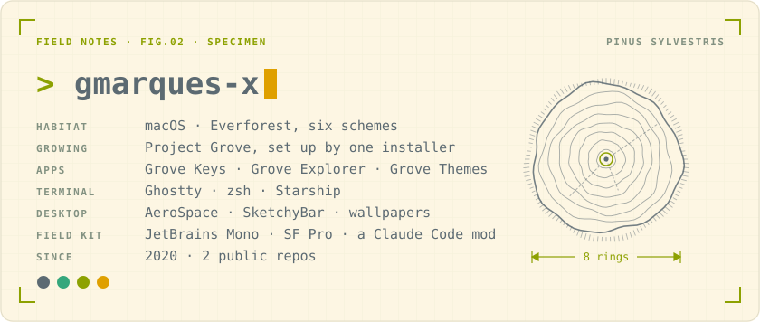
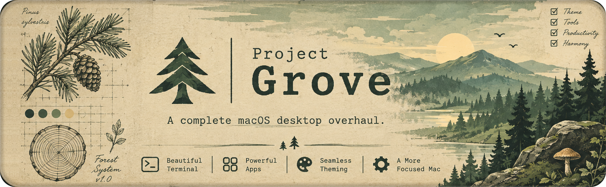
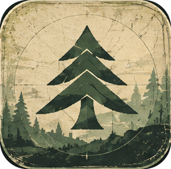
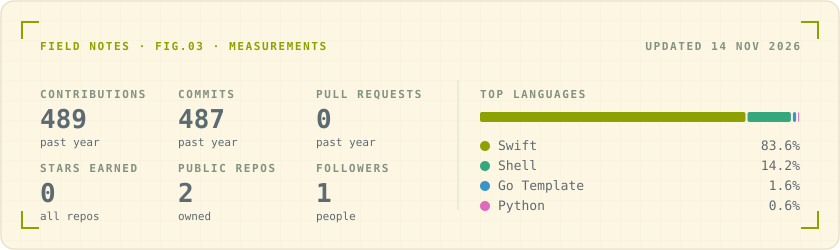

<picture>
  <source media="(prefers-color-scheme: dark)" srcset="https://raw.githubusercontent.com/gmarques-x/gmarques-x/output/specimen-dark.svg">
  <source media="(prefers-color-scheme: light)" srcset="https://raw.githubusercontent.com/gmarques-x/gmarques-x/output/specimen-light.svg">
  
</picture>

  

### Field notes

Notes from a Mac that is being rebuilt one config at a time. Everything here grows from the same ground: the [Everforest](https://github.com/sainnhe/everforest) palette, JetBrains Mono for code and SF Pro for everything else. Every change is recorded, so the whole setup can be planted again on a fresh machine.

### [Project Grove](https://github.com/gmarques-x/project-grove)

A complete macOS desktop overhaul: dotfiles, small purpose-built apps, and third-party tools adapted to fit, all in Everforest.

- **Beautiful terminal.** Shell, prompt and terminal tuned to one palette and one typeface.
- **Powerful apps.** Small tools built for the setup, and familiar apps adapted to it.
- **Seamless theming.** The same colours from the menu bar to the editor.
- **A more focused Mac.** Fewer distractions, and every setting reproducible.

**Growth log**

- [x] Everforest design study and palette
- [x] Fonts: JetBrains Mono and SF Pro, installed by script
- [x] Finder settings recorded and reproducible
- [x] Signed commits with an SSH key
- [x] The grove installer: one command sets up a fresh Mac
- [x] Terminal, shell and editor: Ghostty, zsh, Starship and VS Code
- [x] The desktop: AeroSpace tiling and a SketchyBar bar in place of the menu bar
- [x] Grove Keys: Caps Lock as a Hyper key, launchers and the bar's menus
- [x] Grove Explorer: a file browser with one pane or two
- [x] Grove Themes: switch everything between the six Everforest schemes
- [x] Wallpapers, two for each scheme
- [x] A Claude Code mod: an agents pane, in colours that follow Grove Themes

### Measurements

<picture>
  <source media="(prefers-color-scheme: dark)" srcset="https://raw.githubusercontent.com/gmarques-x/gmarques-x/output/stats-dark.svg">
  <source media="(prefers-color-scheme: light)" srcset="https://raw.githubusercontent.com/gmarques-x/gmarques-x/output/stats-light.svg">
  
</picture>

<picture>
  <source media="(prefers-color-scheme: dark)" srcset="https://raw.githubusercontent.com/gmarques-x/gmarques-x/output/snake-dark.svg">
  <source media="(prefers-color-scheme: light)" srcset="https://raw.githubusercontent.com/gmarques-x/gmarques-x/output/snake-light.svg">
  
</picture>

Set in JetBrains Mono · colours from <a href="https://github.com/sainnhe/everforest">Everforest</a> by sainnhe · cards redrawn daily

